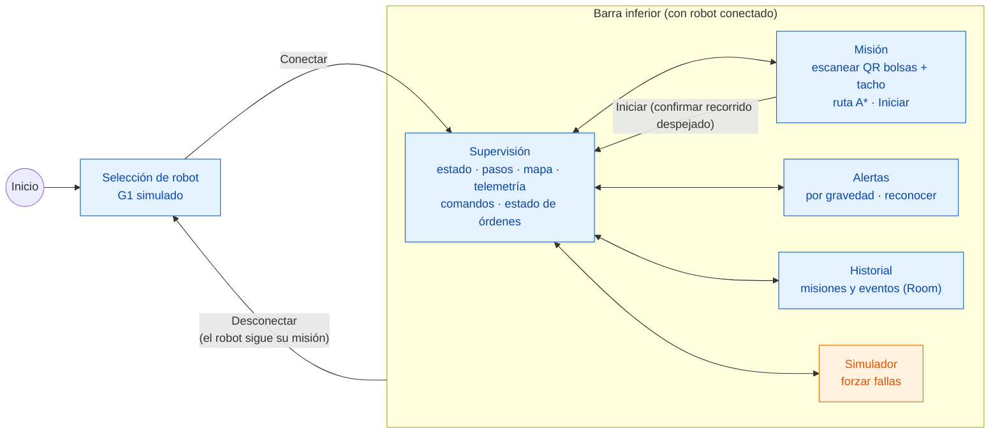
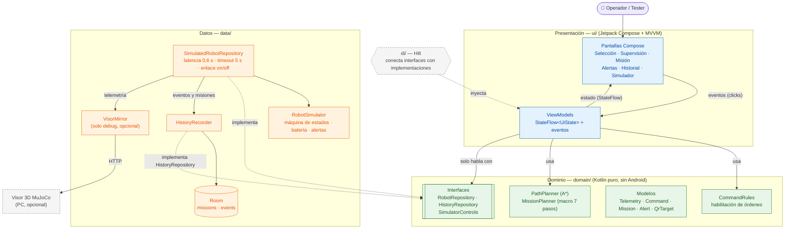
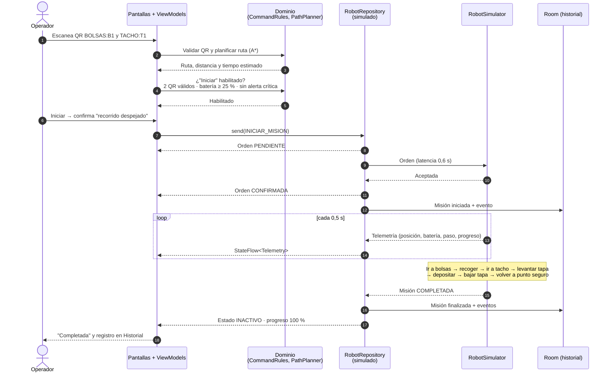
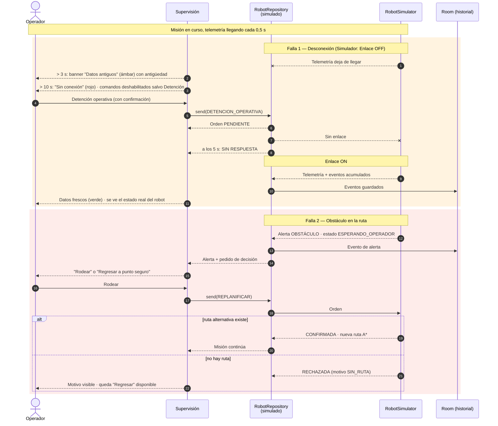

# Robot Tira Basura — HMI para Unitree G1 (simulado)

TP grupal de Desarrollo de Aplicaciones I (UADE): interfaz de operación y supervisión de un **Unitree G1** que
recoge bolsas de basura y las tira en un tacho. El APK funciona **sin robot, sin servidor y sin internet**: el
robot es un simulador que corre dentro de la app, detrás de un `Repository`.

## La misión

1. El operador escanea dos QR impresos: uno marca **dónde están las bolsas** y el otro **dónde está el tacho**.
2. La app calcula la ruta (A* sobre el plano del sitio, esquivando mesas) y muestra distancia y tiempo estimado.
3. Al iniciar, el robot ejecuta la **macro**: ir a las bolsas → recoger bolsa → ir al tacho → levantar tapa →
   depositar bolsa → bajar tapa → volver al punto seguro.

Los QR tienen el formato `RTB:<BOLSAS|TACHO>:<id>:<x>,<y>` (celda del plano). Hay cuatro listos para imprimir en
`docs/qr/`. Sin cámara (emulador), la pestaña Misión ofrece "Simular lectura".

## Cómo correrlo

Requisitos: Android Studio con su JBR (JDK 21) y el SDK de Android 37. Desde la raíz:

```bash
./gradlew assembleDebug          # APK en app/build/outputs/apk/debug/
./gradlew installDebug           # instalar en el emulador o teléfono conectado
./gradlew testDebugUnitTest      # tests JVM (dominio, simulador, repositorio, ViewModels)
```

Si el JDK del sistema es más nuevo que el que soporta Gradle, exportá
`JAVA_HOME` apuntando al JBR de Android Studio.

## Verlo en 3D (opcional)

`mujoco/visor_g1.py` muestra en MuJoCo, con el modelo oficial del G1, lo que hace el robot simulado:
camina por el patio, recoge la bolsa, levanta la tapa y la deposita. Es una visualización
cinemática, sin física. Se activa con `robot.mujocoVisorUrl=http://10.0.2.2:8766/` en
`local.properties` (solo en builds debug). Los pasos están en `mujoco/README.md`.

## Pantallas

| Pestaña | Para qué |
|---|---|
| Selección de robot | Conectarse al G1 simulado |
| Supervisión | Estado, misión y pasos, mapa con ruta, telemetría, comandos, últimas órdenes y su estado |
| Misión | Escanear los dos QR, ver la ruta planificada e iniciar |
| Alertas | Alertas ordenadas por gravedad; reconocerlas |
| Historial | Misiones y eventos guardados en Room (persisten al cerrar la app) |
| Simulador | Uso docente/pruebas: cortar el enlace, perder respuestas, rechazar órdenes, obstáculos, tacho lleno, persona cerca, batería |

### Navegación



## Cómo demostrar los cinco escenarios

| Escenario | Pasos |
|---|---|
| 1. Misión normal | Misión → simular `BOLSAS:B1` y `TACHO:T1` → Iniciar → ver progreso hasta "Completada" |
| 2. Batería baja | Simulador → batería 15 % → aparece alerta y "Regresar a punto seguro"; con 8 % el robot se detiene solo |
| 3. Desconexión | Simulador → apagar "Enlace" → banner "datos antiguos", chip amarillo/rojo, una orden enviada termina "Sin respuesta" → encender el enlace y los datos vuelven |
| 4. Incidente | Durante la misión: Simulador → "Poner obstáculo adelante" → Supervisión pide decisión: rodear o regresar |
| 5. Propio: tacho lleno | Simulador → "Tacho lleno" antes de iniciar → al levantar la tapa el robot espera: reintentar (si se vació) o dejar la bolsa al lado |

## Arquitectura

MVVM con capas, siguiendo las convenciones de la cátedra (mismas que Laburin):

```
ui/        Compose: XRoute (ViewModel + collectAsStateWithLifecycle) y XContent sin estado, previsualizable
           ViewModels con StateFlow<XUiState> y SharedFlow para efectos de una vez (navegación)
domain/    Kotlin puro: modelos, CommandRules (habilitación), PathPlanner (A*), MissionPlanner (macro),
           QrCodes, interfaces RobotRepository / HistoryRepository / SimulatorControls
data/      SimulatedRobotRepository (latencia, timeout, enlace) + RobotSimulator (máquina de estados)
           Room (eventos y misiones) + HistoryRecorder (persiste todo lo que emite el robot)
di/        Hilt. Para un robot real alcanza con cambiar el binding de RobotRepository.
```

### Diagrama de capas



La UI nunca habla con el simulador: solo con `RobotRepository`. Ver `docs/CONTRATO.md` (mensajes JSON) y
`docs/DECISIONES.md` (qué existe en el G1 y qué no, riesgos y limitaciones).

## Flujos

### Flujo normal: misión completa

Enviada no es hecha: la orden pasa de *pendiente* a *confirmada* solo cuando el robot responde.



### Flujo con falla: desconexión y obstáculo

Si se corta el enlace, la app marca los datos como antiguos y las órdenes terminan "Sin respuesta". Si aparece un obstáculo, el robot espera la decisión del operador.


